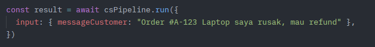
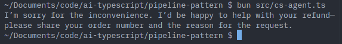

# CS Agent Pipeline

Demo belajar **pipeline pattern** untuk agentic workflow: satu pipeline, 5 step,
3 pola (router, extraction, evaluator-optimizer) dibangun dengan
[`@anvia/core`](https://www.npmjs.com/package/@anvia/core) + zod.

## Alur pipeline

```
{ messageCustomer }                      ← input: pesan customer (argv CLI)
   ▼
[1] classify   → z.enum intent (router — kode yang memutuskan)
[2] extract    → { order_id, product, issue_summary } (extraction)
[3] draft      → gate "general" (tanpa AI) / prompt khusus per intent
[4] evaluate   → { passed, feedback } (evaluator)
[5] revise     → passed ? reply : revisi pakai feedback
   ▼
balasan final
```

Belt rule: **return step n = input step n+1.** Semua step spread `{ ...input }`,
output LLM selalu di-`Schema.parse()` (unknown → tipe).

## Menjalankan

```bash
bun install
cp .env.example .env        # isi OPENAI_BASE_URL & OPENAI_API_KEY

bun src/cs-agent.ts "Order #A-123 blender rusak, mau refund"   # jalur intent
bun src/cs-agent.ts "halo CS?"                                  # jalur gate general
```

## Demo

Jalur refund — classify → extract → draft → evaluate → revise:
Contoh Pesan Customer



Run di CLI


# cs-agent-pipeline
